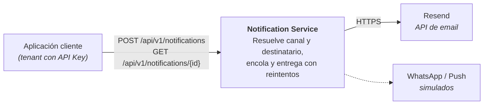
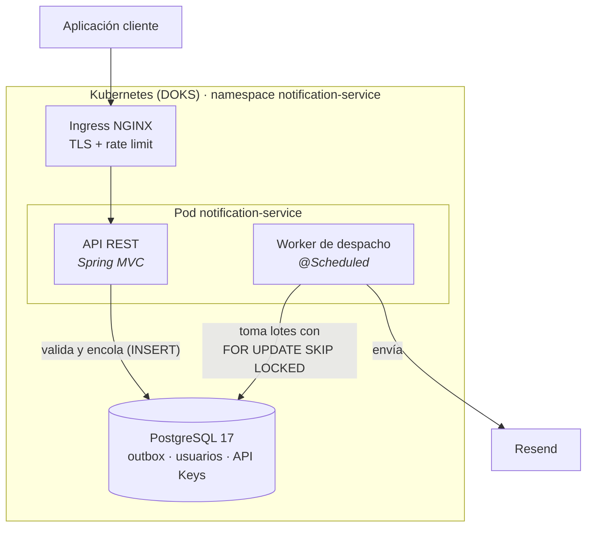
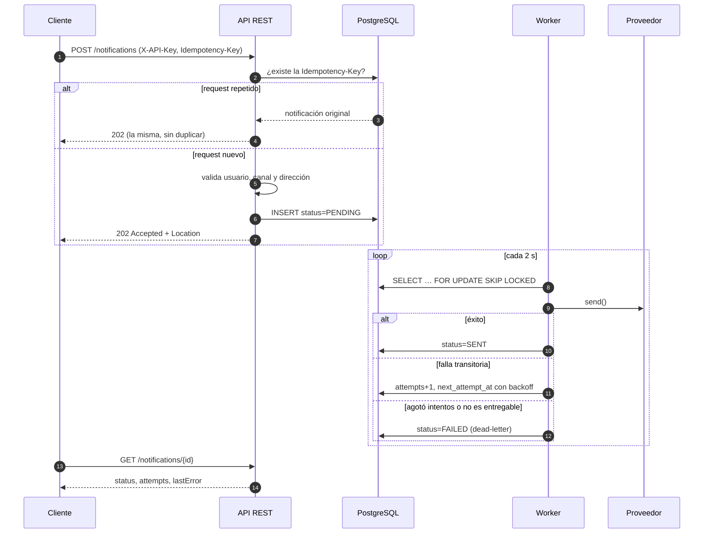
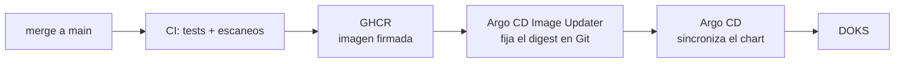

# Notification Service

[](https://github.com/alexis1986/notification-service/actions/workflows/ci.yml)

Servicio de notificaciones multi-tenant y multi-canal (email, WhatsApp, push) con entrega asíncrona confiable. Está construido con Spring Boot 4.1 y Java 21 sobre una arquitectura hexagonal, y corre en Kubernetes (DigitalOcean) con GitOps.

**Demo en vivo:** [notifications.alexdevvv.com/swagger-ui.html](https://notifications.alexdevvv.com/swagger-ui.html)

---

## El problema

Varias aplicaciones (los *clientes*) necesitan avisarle algo a sus usuarios. Cada una no debería tener que saber por qué canal prefiere enterarse cada usuario, a qué dirección escribirle, ni qué hacer cuando el proveedor de email está caído.

El servicio toma esa responsabilidad. Con cuatro requisitos:

- **No perder notificaciones** aunque el proveedor falle o el pod se reinicie.
- **No duplicarlas** cuando el cliente reintenta un request que no sabe si llegó.
- **Aislar a los clientes**: cada uno ve solo sus usuarios y sus notificaciones.
- **Sumar canales sin tocar la lógica de negocio.**

## La solución en una mirada

### Contexto



### Contenedores



### Cómo viaja una notificación



## Decisiones de diseño

Cada decisión con trade-offs está registrada como ADR en [`docs/adr`](docs/adr/README.md):

| ADR | Decisión |
|---|---|
| [0001](docs/adr/0001-arquitectura-hexagonal.md) | Arquitectura hexagonal con un adapter por canal |
| [0002](docs/adr/0002-outbox-en-postgresql.md) | Outbox en PostgreSQL en lugar de un broker de mensajes |
| [0003](docs/adr/0003-entrega-at-least-once.md) | Entrega *at-least-once* |
| [0004](docs/adr/0004-transaccion-abierta-durante-el-envio.md) | El envío ocurre dentro de la transacción del lote |
| [0005](docs/adr/0005-idempotency-key-sin-ttl.md) | `Idempotency-Key` por cliente, sin expiración |
| [0006](docs/adr/0006-202-en-lugar-de-502.md) | `202 Accepted` siempre; los fallos del proveedor no llegan al cliente |
| [0007](docs/adr/0007-resend-por-http.md) | Email por la API HTTP de Resend en lugar de SMTP |
| [0008](docs/adr/0008-demo-publica.md) | Demo pública con API Keys conocidas |
| [0009](docs/adr/0009-spring-boot-4.md) | Migración a Spring Boot 4 |

## Confiabilidad

- **Patrón outbox.** El `POST` solo valida y persiste; nunca habla con el proveedor. Si la base confirmó el `INSERT`, la notificación no se pierde.
- **Reintentos con backoff exponencial.** La espera arranca en 10 s y se duplica en cada intento, con tope de 10 min; son 5 intentos en total. Después la notificación queda `FAILED`, que actúa como dead-letter consultable.
- **Errores permanentes vs. transitorios.** Si el usuario o su dirección no existen, la notificación va directo a `FAILED`, porque reintentar no lo arregla. Cualquier otro error se reintenta.
- **Varias réplicas sin coordinación.** `FOR UPDATE SKIP LOCKED` reparte lotes disjuntos entre workers. Está probado con un test de concurrencia sobre PostgreSQL real.
- **Reintentos del cliente sin duplicados.** Con el header `Idempotency-Key`, la carrera entre dos requests iguales la resuelve un índice único parcial en la base.
- **Probes de Kubernetes.** Liveness no depende de la base, porque reiniciar el pod no la arregla. Readiness sí, para sacar el pod del balanceo mientras PostgreSQL no responde.

## Seguridad y supply chain

- **API Keys hasheadas.** Se guardan con SHA-256: una fuga de la base no expone credenciales usables.
- **Aislamiento por tenant.** Cada consulta filtra por `client_id`. El `id` de otro cliente responde `404`, no `403`, para no revelar que existe.
- **Contenedor endurecido.** Usuario no-root, sistema de archivos de solo lectura, sin shell de login, capabilities descartadas y `seccomp` RuntimeDefault.
- **Pipeline de seguridad en cada push**, con [workflows reutilizables propios](https://github.com/alexis1986/security-workflows):
  - secretos con gitleaks;
  - SAST con Semgrep;
  - dependencias e IaC con Trivy;
  - escaneo de la imagen.
- **Imagen firmada y con SBOM.** La imagen que se publica es la misma que se escaneó, sin rebuild.
- **Dependencias al día.** Las GitHub Actions están fijadas por SHA y Dependabot las actualiza con un cooldown de 7 días.

## Operación

El despliegue vive en [`homelab-infra`](https://github.com/alexis1986/homelab-infra), la infraestructura compartida de los proyectos del portafolio:



- **Helm chart propio.** PostgreSQL corre como StatefulSet con un volumen de bloque. TLS con cert-manager y Let's Encrypt; DNS con Terraform.
- **Perfil `prod`.** La conexión a la base es obligatoria, no carga datos de demo y respeta los headers `X-Forwarded-*` del Ingress. Los logs salen en JSON (formato ECS) para indexarlos sin parsear texto.
- **Imagen por capas.** Un cambio de código solo invalida la última capa, y el heap se dimensiona según el límite de memoria del contenedor.

## Probarlo

### Contra la demo en vivo

Las API Keys de demo son públicas a propósito: los emails van a direcciones de prueba de Resend (`@resend.dev`) y el Ingress limita a 30 requests por minuto. Ver [ADR 0008](docs/adr/0008-demo-publica.md).

```bash
API=https://notifications.alexdevvv.com
API_KEY=key-for-client-a

# Encola un email para user1 (su canal preferido es EMAIL)
curl -i -X POST $API/api/v1/notifications \
  -H "Content-Type: application/json" \
  -H "X-API-Key: $API_KEY" \
  -H "Idempotency-Key: demo-$(date +%s)" \
  -d '{"userId": "user1", "subject": "Hola", "body": "Probando el servicio"}'

# Consulta el estado con la URL del header Location
curl $API/api/v1/notifications/<id> -H "X-API-Key: $API_KEY"
```

O desde [Swagger UI](https://notifications.alexdevvv.com/swagger-ui.html): botón *Authorize* y la API Key.

| API Key | Cliente | Usuario | Canal preferido |
|---|---|---|---|
| `key-for-client-a` | `client-a` | `user1` | `EMAIL` |
| `key-for-client-a` | `client-a` | `user2` | `WHATSAPP` |
| `super-secret-key-for-b` | `client-b` | `user1` | `PUSH` |

### En local

Solo hace falta Docker.

```bash
# Servicio con perfil prod + PostgreSQL + Mailpit (emails en http://localhost:8025)
docker compose up --build

# O el servicio con un PostgreSQL efímero (Testcontainers)
./mvnw spring-boot:test-run
```

## API

| Método | Ruta | Respuesta |
|---|---|---|
| `POST` | `/api/v1/notifications` | `202` con `Location` · `401` sin API Key válida · `404` usuario inexistente · `422` sin dirección para el canal o `Idempotency-Key` reusada con otro contenido |
| `GET` | `/api/v1/notifications/{id}` | `200` con el estado · `404` si no existe o es de otro cliente |

Los errores siguen [RFC 9457 (Problem Details)](https://www.rfc-editor.org/rfc/rfc9457). El contrato completo está en `/v3/api-docs`.

Campos del body:

- `userId` (obligatorio): el servicio resuelve el canal y la dirección según las preferencias del usuario.
- `subject` y `body`: el contenido de la notificación.
- `type` (opcional): `EMAIL`, `WHATSAPP` o `PUSH`, para forzar un canal e ignorar la preferencia.

## Configuración

Todo se configura por variables de entorno.

| Variable | Default | Descripción |
|---|---|---|
| `SPRING_PROFILES_ACTIVE` | — | `prod` exige `DB_*`, no carga datos de demo y emite logs ECS |
| `DB_URL` | `jdbc:postgresql://localhost:5432/notifications` | URL JDBC de PostgreSQL |
| `DB_USERNAME` / `DB_PASSWORD` | `notifications` / `notifications` | Credenciales de la base |
| `FLYWAY_LOCATIONS` | `classpath:db/migration,classpath:db/demo` | Sin `db/demo` solo se aplica el esquema (default en `prod`) |
| `MAIL_PROVIDER` | `smtp` | `smtp` o `resend` |
| `MAIL_FROM` | `no-reply@alexdevvv.com` | Remitente |
| `RESEND_API_KEY` | vacío | Requerida con `MAIL_PROVIDER=resend` |
| `MAIL_HOST` / `MAIL_PORT` | `localhost` / `1025` | SMTP (por ejemplo Mailpit) |
| `MAIL_USERNAME` / `MAIL_PASSWORD` | vacío | Credenciales SMTP |
| `MAIL_SMTP_AUTH` / `MAIL_SMTP_STARTTLS` | `false` / `false` | Autenticación y STARTTLS |
| `DISPATCH_INTERVAL` | `PT2S` | Cada cuánto el worker busca pendientes |
| `DISPATCH_BATCH_SIZE` | `20` | Notificaciones por lote |
| `DISPATCH_MAX_ATTEMPTS` | `5` | Intentos antes de `FAILED` |
| `DISPATCH_INITIAL_BACKOFF` / `DISPATCH_MAX_BACKOFF` | `PT10S` / `PT10M` | Backoff: se duplica en cada intento hasta el máximo |

## Desarrollo

```bash
./mvnw verify   # tests unitarios + integración contra PostgreSQL real (Testcontainers)
```

- **Unitarios:** el dominio y los casos de uso se prueban sin framework, con Mockito.
- **Integración:** cubren la API completa, la concurrencia del claim, la carrera de la `Idempotency-Key`, los probes y el perfil `prod`.

Las convenciones de arquitectura, paquetes y commits están en [`AGENTS.md`](AGENTS.md). Para sumar un canal (por ejemplo SMS) alcanza con un adapter nuevo que implemente `NotificationSenderPort`: no se modifican los casos de uso.

## Limitaciones conocidas

- WhatsApp y Push están simulados: se registran en el log.
- Un `4xx` del proveedor (por ejemplo, un email mal formado) se reintenta como si fuera transitorio, aunque con tope de 5 intentos.
- Las `Idempotency-Key` no expiran ([ADR 0005](docs/adr/0005-idempotency-key-sin-ttl.md)).
- No hay alta de clientes por API: las API Keys se cargan por migración o directo en la base.
